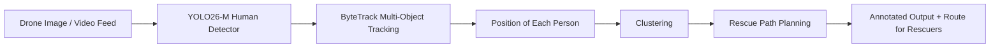
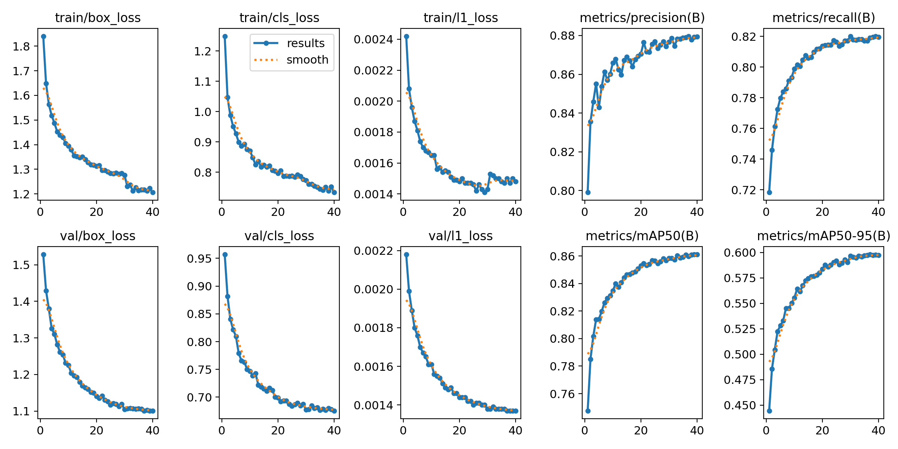
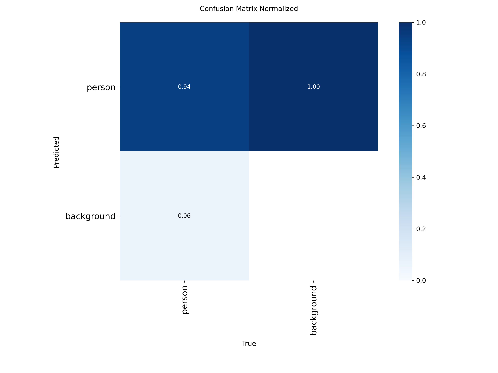
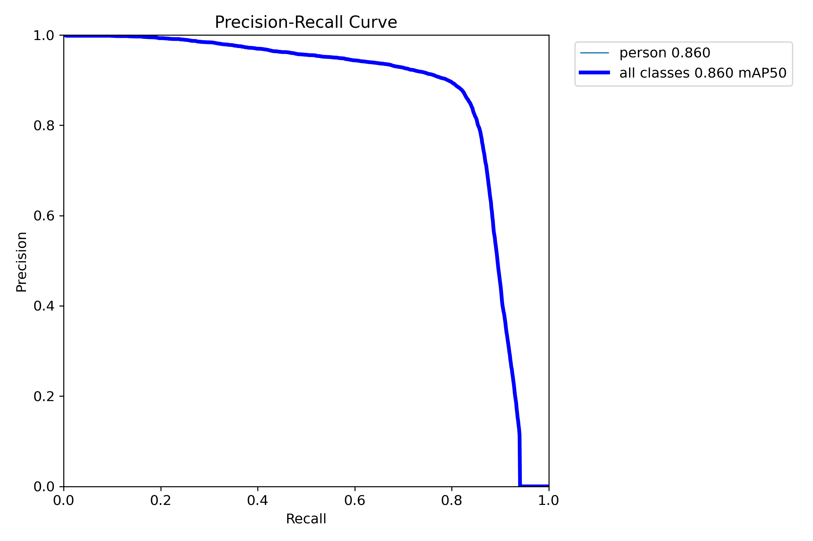
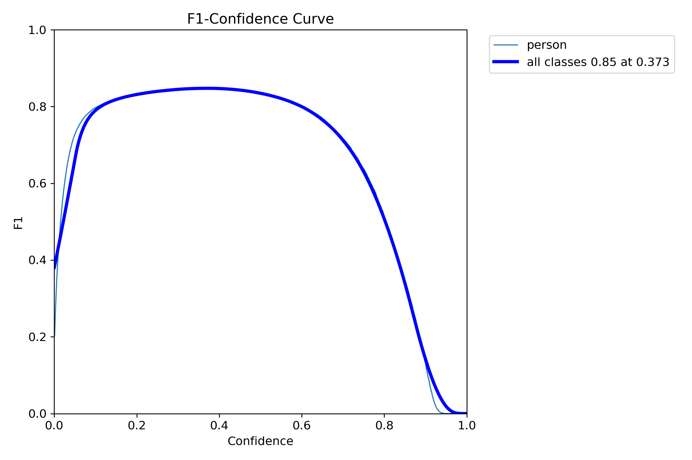
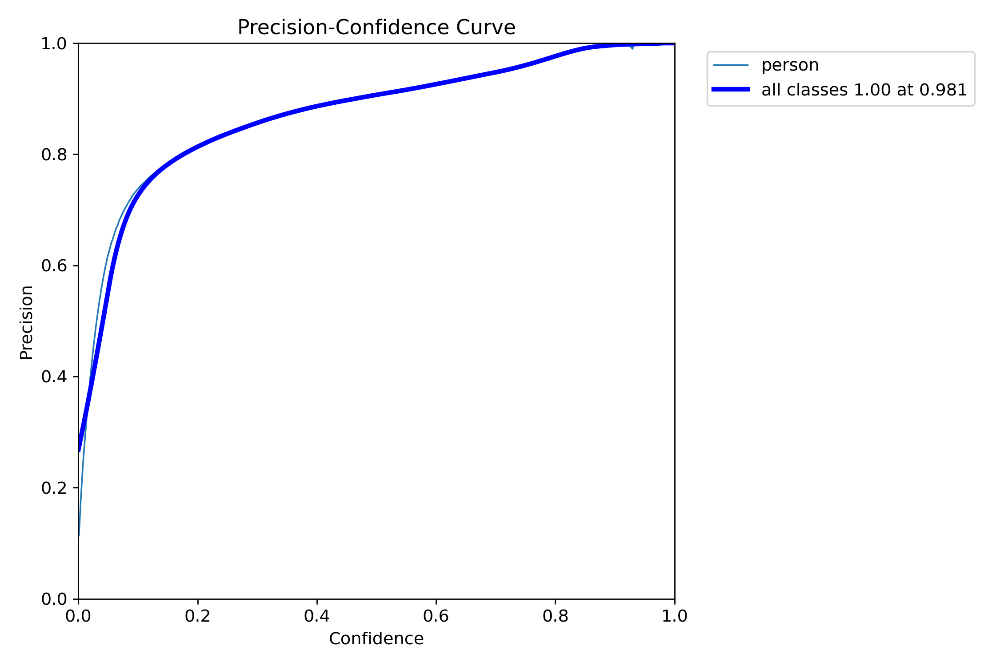

<div align="center">

# ResQVision

### Drone-Based Human Detection, Clustering & Rescue Path Planning for Flood Disasters

[](https://www.python.org/)
[](https://pytorch.org/)
[](https://docs.ultralytics.com/)
[](https://opencv.org/)
[](LICENSE)
[]()

<!-- Replace with your demo GIF -->


</div>

---

## 📌 Table of Contents

- [Overview](#-overview)
- [Key Features](#-key-features)
- [System Architecture](#-system-architecture)
- [Datasets](#-datasets)
- [Model & Training](#-model--training)
- [Results](#-results)
- [Tracking](#-tracking)
- [Clustering & Rescue Path Planning](#-clustering--rescue-path-planning)
- [Installation](#-installation)
- [Usage](#-usage)
- [Repository Structure](#-repository-structure)
- [Experiments & Lessons Learned](#-experiments--lessons-learned)
- [Future Hardware Roadmap](#-future-hardware-roadmap)
- [Limitations](#-limitations)
- [Roadmap](#-roadmap)
- [License](#-license)
- [Acknowledgements](#-acknowledgements)
- [Authors](#-authors)

---

## 🌊 Overview

During floods, locating stranded people quickly decides who survives. Ground teams are slow, boats cannot reach everywhere, and people often appear as tiny objects in aerial footage.

**ResQVision** is an end-to-end rescue-support pipeline built on aerial imagery:

1. **Detect** humans in flooded areas from drone images and video using **YOLO26-Medium**.
2. **Track** them across frames in real time with **ByteTrack** to avoid double counting.
3. **Cluster** nearby people into groups so rescuers see where help is needed most.
4. **Plan a path** through the clusters so rescue teams can reach as many people as possible, as fast as possible.

---

## ✨ Key Features

-  Flood-specific human detection fine-tuned on the **C2A** dataset
-  Pre-training on **VisDrone-DET** for general aerial human appearance (small, top-down views)
-  Multi-object tracking with **ByteTrack** (VisDrone-MOT and VisDrone video)
-  Spatial clustering of detected people into rescue groups
-  Route computation across clusters for rescue teams
-  NMS-free end-to-end inference from YOLO26, suited to real-time monitoring and future edge deployment

---

## 🏗️ System Architecture



> 📝 **TODO:** replace or extend with your own architecture diagram at `assets/architecture.png` if you have one.

---

## 📦 Datasets

| Dataset | Purpose | Source |
|---|---|---|
| **VisDrone-DET** | Aerial human detection (pre-training / general aerial robustness) | [VisDrone](https://github.com/VisDrone/VisDrone-Dataset) |
| **VisDrone-MOT** | Multi-object tracking (ByteTrack) | [VisDrone](https://github.com/VisDrone/VisDrone-Dataset) |
| **VisDrone Video** *(secondary)* | Tracking demonstrations / evaluation | [VisDrone](https://github.com/VisDrone/VisDrone-Dataset) |
| **C2A** | Flood and disaster-specific human detection (final training) | [Kaggle](https://www.kaggle.com/datasets/rgbnihal/c2a-dataset) |

<!-- TODO: fill the exact numbers you used after filtering -->
| Split | Images | Notes |
|---|---|---|
| Train | `TODO` | |
| Validation | `TODO` | |
| Test | 558 | 19,139 annotated person instances |

**Classes used:** `person` *(TODO: confirm, e.g. whether VisDrone `pedestrian` and `people` were merged)*

> ⚠️ Please download datasets from their official sources and follow their respective licenses. Datasets are **not** redistributed in this repository.

---

## 🧠 Model & Training

**Model:** [Ultralytics YOLO26-Medium](https://docs.ultralytics.com/) (`yolo26m`)

Why YOLO26:
- Native **end-to-end, NMS-free** inference (lower latency, simpler deployment)
- DFL removed for a lighter regression head and easier export to edge devices
- Strong accuracy–latency trade-off at the medium scale

**Training setup**

| Parameter | Value |
|---|---|
| Base weights | `yolo26m.pt` (COCO pre-trained) |
| Training stages | VisDrone-DET → C2A *(TODO: confirm)* |
| Epochs | `TODO` |
| Image size | `TODO` |
| Batch size | `TODO` |
| Optimizer | `TODO` |
| Augmentations | `TODO` |
| Hardware | NVIDIA Tesla T4 (15 GB), Google Colab |
| Model size | 20.35 M parameters, 68.1 GFLOPs (fused) |
| Framework | Ultralytics 8.4.215, PyTorch 2.14.1 + CUDA |

---

## 📊 Results

### Quantitative (C2A test set: 558 images, 19,139 instances)

The VisDrone-trained model (baseline) is compared with the same model fine-tuned on flood-specific C2A data.

| Metric | Original (VisDrone) | **Flood fine-tuned (C2A)** | Gain |
|---|---|---|---|
| Precision | 0.775 | **0.878** | +0.103 |
| Recall | 0.628 | **0.813** | +0.185 |
| mAP@50 | 0.706 | **0.848** | +0.142 |
| mAP@50-95 | 0.335 | **0.601** | +0.266 |

| Speed (Tesla T4, per image) | Original | Fine-tuned |
|---|---|---|
| Preprocess | 2.4 ms | 2.1 ms |
| Inference | 45.8 ms | 48.9 ms |
| Postprocess | 2.2 ms | 1.8 ms |

Roughly 53 ms end-to-end per image on a T4 (about 19 FPS) with `yolo26m`. Smaller variants or TensorRT export should run faster on edge hardware.

<p align="center">
  
</p>

<details>
<summary>Raw evaluation log</summary>


</details>

> Fine-tuning on C2A turns a model that barely works on flood scenes (mAP@50 of 14%) into a strong detector (mAP@50 of 84.8%). The original model never saw flood backgrounds, so this gap shows why domain-specific data matters.

### Training Curves

<!-- TODO: copy results.png from your Ultralytics run folder into assets/results/ -->

<p align="center">
  
</p>

### Evaluation Plots

<table>
  <tr>
    <td align="center"><br/><b>Confusion Matrix</b></td>
    <td align="center"><br/><b>Precision–Recall Curve</b></td>
  </tr>
  <tr>
    <td align="center"><br/><b>F1–Confidence Curve</b></td>
    <td align="center"><br/><b>Precision–Confidence Curve</b></td>
  </tr>
</table>

### Sample Predictions (Fine-tuned YOLO26m on C2A test images)

<table>
  <tr>
    <td align="center"><br/><sub>Dense scene around a submerged car: <b>46 people</b> detected</sub></td>
    <td align="center"><br/><sub>Flooded residential street: <b>45 people</b> detected</sub></td>
  </tr>
  <tr>
    <td align="center"><br/><sub>Flooded campus, small and distant people: <b>17 people</b> detected</sub></td>
    <td align="center"><br/><sub>Flooded suburb with rooftops and trees: <b>29 people</b> detected</sub></td>
  </tr>
</table>

The model handles crowded scenes, tiny people seen from high altitude, and cluttered backgrounds (roofs, trees, vehicles). Low-confidence boxes (about 0.4 to 0.5) appear in the hardest scenes, so the confidence threshold can be tuned for recall vs. false alarms.

> Full result images and extra runs are available in [Google Drive](https://drive.google.com/drive/folders/1oQ9kjRVFWxHxcJqanipim-dg3xA_A8vG?usp=drive_link) and inside the [`notebooks/`](notebooks/) outputs.

---

## 🎞️ Tracking

ResQVision uses **ByteTrack** on top of YOLO26 detections to keep a stable ID per person across frames, giving stable counts and positions for clustering.

<p align="center">
  
</p>

| Tracking metric | Value |
|---|---|
| MOTA | `TODO` |
| IDF1 | `TODO` |
| ID switches | `TODO` |

*(Tracking is evaluated on VisDrone-MOT / VisDrone video, not on flood footage.)*

---

## 🧭 Clustering & Rescue Path Planning

After detection, each person is reduced to a point (bounding-box centre). Then:

1. **Clustering:** nearby people are grouped into rescue clusters using `TODO: DBSCAN / K-Means / other` with `TODO: parameters`.
2. **Cluster priority:** clusters can be ranked by size (number of people).
3. **Path planning:** a route visiting the clusters is computed using `TODO: nearest-neighbour / TSP / A* / other`.

<p align="center">
  
</p>

> 📝 Current paths are computed in image/pixel space. Mapping to real GPS coordinates needs drone telemetry (altitude, camera angle, GPS), which is part of the hardware roadmap.

---

## ⚙️ Installation

```bash
# 1. Clone
git clone https://github.com/Anikettcoder/ResQVision.git
cd ResQVision

# 2. Create environment
python -m venv venv
source venv/bin/activate        # Windows: venv\Scripts\activate

# 3. Install dependencies
pip install -r requirements.txt
```

Core dependencies (`TODO: pin versions`): `ultralytics`, `torch`, `torchvision`, `opencv-python`, `numpy`, `scikit-learn`, `matplotlib`, `networkx` *(adjust to your actual imports)*.

---

## 🚀 Usage

> Replace paths with your own weights. Notebooks in [`notebooks/`](notebooks/) contain the full workflow.

**Train**
```python
from ultralytics import YOLO

model = YOLO("yolo26m.pt")
model.train(data="c2a.yaml", epochs=100, imgsz=640, batch=16)   # TODO: your values
```

**Detect on an image**
```python
model = YOLO("weights/best.pt")
results = model.predict("path/to/image.jpg", conf=0.25, save=True)
```

**Track on a video (ByteTrack)**
```python
model.track(source="path/to/video.mp4", tracker="bytetrack.yaml", conf=0.25, save=True)
```

---

## 📁 Repository Structure

```
ResQVision/
├── notebooks/          # Training, evaluation, tracking, clustering & path planning notebooks
├── assets/             # README images (results, demo GIFs)   <- add this
│   ├── results/
│   ├── tracking/
│   └── demo/
├── weights/            # Trained model weights (or link)       <- optional
├── requirements.txt    #                                       <- add this
├── LICENSE
└── README.md
```
*(TODO: update to match the real contents of `notebooks/`.)*

---

## 🔬 Experiments & Lessons Learned

- **SAHI (Slicing Aided Hyper Inference):** tested tiled inference to help with small humans. It produced **no measurable improvement** on our results, so it was removed from the final pipeline. YOLO26's small-object handling and training at suitable resolution were already sufficient for our data.
- **Two-stage data strategy:** general aerial data (VisDrone) plus flood-specific data (C2A) for domain adaptation.
- *(TODO: add other ablations: YOLO26-S vs M, image size, with/without VisDrone pre-training.)*

---

## 🛩️ Future Hardware Roadmap

Current work is software-only and runs on recorded imagery and video. Planned hardware for field deployment:

| Component | Candidate | Purpose |
|---|---|---|
| Drone | Enterprise quadcopter (e.g. DJI Matrice / Mavic-class, or custom build with Pixhawk) | Flood-area survey flights |
| Camera | High-res RGB gimbal camera | Detection of small humans |
| Thermal camera | Radiometric thermal sensor | Night / low-visibility rescue |
| Edge computer | NVIDIA Jetson Orin Nano / NX | On-board real-time YOLO26 inference |
| Telemetry | GPS + IMU + altitude sensor | Pixel → GPS conversion for real-world routes |
| Link | Long-range video/telemetry link (4G/5G or dedicated RF) | Live feed to ground control |
| Ground station | Laptop / tablet dashboard | Live map with clusters and routes |

*These are planned, not yet purchased or tested.*

---

## ⚠️ Limitations

- Trained on recorded data; **not yet validated in live flight**.
- C2A is a flood and disaster dataset built from synthetic compositing of people on aerial backgrounds (verify in the dataset paper), so a domain gap to real flood footage may remain.
- Very small, partially submerged or occluded people can be missed, and heavily overlapping people in dense crowds can produce overlapping or duplicate boxes.
- Results are on the C2A test split only; performance on other real-world flood footage is not yet measured.
- Path planning is currently 2D and ignores terrain, water currents and boat access.
- Not a certified life-safety system. Use as decision support only.

---

## 🗺️ Roadmap

- [x] Human detection with YOLO26-M
- [x] Training on VisDrone-DET and C2A
- [x] ByteTrack integration
- [x] Clustering and path planning prototype
- [ ] Real-time inference demo (webcam / live stream)
- [ ] Export to ONNX / TensorRT
- [ ] Pixel → GPS mapping and live map dashboard
- [ ] Thermal imaging support
- [ ] Field testing on real drone hardware
- [ ] Multi-drone coordination

---

## 📄 License

This project is released under the [MIT License](LICENSE).

> **Note:** YOLO26 / Ultralytics is licensed under **AGPL-3.0** (commercial license available from Ultralytics). Check the license terms before using model weights or this pipeline commercially. VisDrone and C2A have their own dataset licenses.

---

## 🙏 Acknowledgements

- [Ultralytics](https://github.com/ultralytics/ultralytics) for YOLO26
- [VisDrone Dataset](https://github.com/VisDrone/VisDrone-Dataset) by the AISKYEYE team, Tianjin University
- [C2A Dataset](https://www.kaggle.com/datasets/rgbnihal/c2a-dataset)
- [ByteTrack](https://github.com/ifzhang/ByteTrack) by Zhang et al.

### Citation

```bibtex
@software{resqvision2026,
  title  = {ResQVision: Drone-Based Human Detection and Rescue Path Planning in Floods},
  author = {Aniket and contributors},
  year   = {2026},
  url    = {https://github.com/Anikettcoder/ResQVision}
}
```

---

## 👤 Authors

**Aniket** — [GitHub](https://github.com/Anikettcoder) · [LinkedIn](https://linkedin.com/in/TODO) · Email: `TODO`

*Team members / supervisor: `TODO`*

---

<div align="center">
⭐ If this project helps you, consider giving it a star.
</div>
